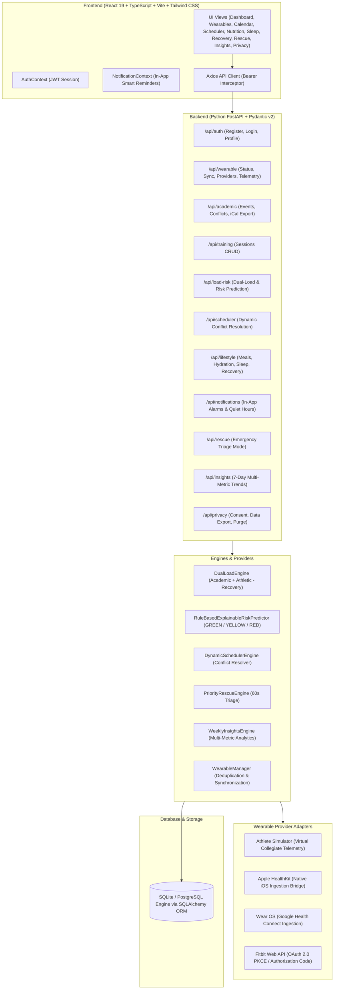

# DualWell: Architecture & Engineering Specification

## 1. Executive Summary
**DualWell: Smart Student Wellness and Academic Performance System** is a full-stack web application designed for active collegiate students and student-athletes who must navigate the demanding interplay between intense physical training and high-stakes academic workloads.

DualWell combines smartwatch telemetry (heart rate, HRV, steps, resting HR, and sleep stages) with academic commitments (exams, assignments, classes, study sessions) to evaluate acute cognitive and physical stress, detect overload risks, and deliver non-destructive scheduling and recovery interventions.

---

## 2. System Architecture

---

## 3. Mathematical Dual-Load Calculation Formulas

### 3.1. Academic Load Score ($0 \le S_{acad} \le 100$)
$$S_{acad} = \min\left(100, \, \left(\frac{H_{weighted}}{7.0} \times 65\right) + P_{exam} + B_{consecutive}\right)$$
Where:
- $H_{weighted} = \sum_{i} d_i \times w_{priority, i}$ ($d_i$ is duration in hours, $w_{priority}$ is $1.8$ for Critical, $1.4$ for High, $1.0$ for Medium, $0.8$ for Low).
- $P_{exam} = \min(35, \, N_{exam, 48h} \times 18)$ accounts for impending exam proximity within 48 hours.
- $B_{consecutive} = 8$ points if any continuous study block exceeds 3.5 hours without interruption.

### 3.2. Athletic Load Score ($0 \le S_{ath} \le 100$)
$$S_{ath} = \min\left(100, \, \left(\frac{\sum_j \text{duration}_j \times I_j}{75.0}\right) \times 85 + \min(15, \, F_{7d} \times 2.5)\right)$$
Where intensity multipliers $I_j$ are:
- `all_out`: $1.2$
- `high`: $0.9$
- `moderate`: $0.5$
- `light`: $0.3$
- $F_{7d}$ is session frequency over the trailing 7 days.

### 3.3. Recovery Readiness Score ($10 \le S_{rec} \le 100$)
$$S_{rec} = \max\left(10, \, \min\left(100, \, (S_{sleep} \times 0.55) + (S_{hrv} \times 0.45) - P_{subjective}\right)\right)$$
Where:
- $S_{sleep} = \min(100, \, (\text{Actual Sleep Hours} / \text{Target Hours}) \times 100)$.
- $S_{hrv}$ evaluates nocturnal rMSSD baseline: $\ge 65\text{ms} \to 92$, $50\text{--}64\text{ms} \to 80$, $35\text{--}49\text{ms} \to 60$, $<35\text{ms} \to 40$.
- $P_{subjective}$ penalizes recovery by up to 22 points when reported muscle soreness or mental exhaustion $\ge 7/10$.

### 3.4. Combined Dual-Load Risk Score ($0 \le R \le 100$)
$$R = \min\left(100, \, \left(\frac{0.45 \times S_{acad} + 0.40 \times S_{ath}}{85.0} \times 100\right) \times \left(\frac{1.0 + \frac{100 - S_{rec}}{100} \times 0.50}{1.25}\right)\right)$$

### 3.5. Risk Classification Tiers
- **GREEN ($R < 42.0$):** Optimal balance. Recovery reserves readily accommodate current workload.
- **YELLOW ($42.0 \le R < 70.0$):** Elevated dual load. Recovery reserve tightening; proactive rescheduling advised.
- **RED ($R \ge 70.0$):** Critical overload risk. Immediate Priority Rescue Mode triage required.

---

## 4. Database Schema & Persistence
Persisted in local SQLite database `dualwell.db` (or configurable PostgreSQL):
1. `users` & `student_profiles`: Student credentials, timetable baselines, sport, sleep and hydration goals.
2. `privacy_preferences`: Telemetry sync consent, quiet hours window, notification preferences.
3. `wearable_connections` & `wearable_observations`: Deduplicated observation streams with provenance tags (`WEARABLE_LIVE`, `SIMULATED_DEMO`, `MANUAL_ENTRY`).
4. `academic_events`: Coursework, exams, deadlines, priorities, completion status.
5. `training_sessions`: Workouts, sport type, intensity, heart rate telemetry.
6. `daily_load_snapshots`: 7-day chronological load, recovery, and risk calculations.
7. `risk_assessments`: Explainable rule-based assessments and actionable triage recommendations.
8. `schedule_recommendations`: Proposed non-destructive timetable adjustments.
9. `meal_logs` & `hydration_logs`: Daily nutrition and fluid intake history.
10. `sleep_records`: Nightly duration and sleep stages (Deep, REM, Light).
11. `recovery_checkins`: Muscle soreness, mental fatigue, and injury pain warnings.
12. `reminders`: In-app smart alarms and notifications.
